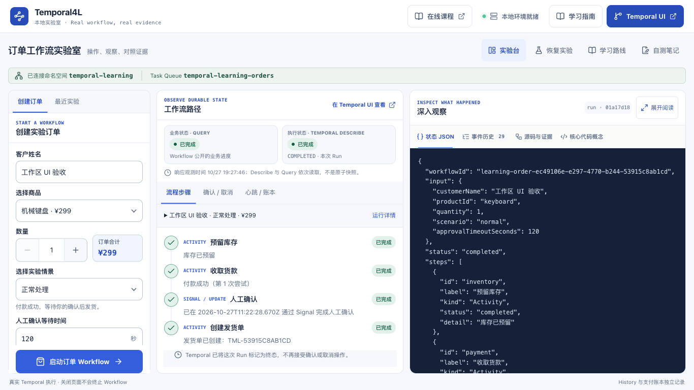

# Temporal4L · Temporal Lab

[](https://github.com/likebeans/temporal4l/actions/workflows/ci.yml)
[](https://github.com/likebeans/temporal4l/actions/workflows/codeql.yml)
[](LICENSE)
[](package.json)

**通过真实运行、故障实验和独立练习，学习 Temporal。**

[在线学习](https://likebeans.github.io/temporal4l/) · [学习路径](docs/learning-path.md) · [文档目录](docs/README.md) · [迁移练习](exercises/README.md) · [参与贡献](CONTRIBUTING.md) · [问题与讨论](https://github.com/likebeans/temporal4l/discussions)

一个可以在浏览器里操作的中文 Temporal 入门示例。通过「预留库存 → 收款 → 人工确认 → 可选分批打包 → 发货」这条订单流程，理解持久化执行、Activity 重试、Signal、Update、Query、Timer、幂等、心跳和补偿。

**订单确实运行在 Temporal 中。** 库存、支付、发货是模拟业务，不会产生真实扣款或调用外部服务。业务状态来自 Workflow Query，执行状态与心跳来自 Temporal Describe，事件来自真实 History；模拟支付流水保存在独立 SQLite 账本。

第一次学习请按[五阶段学习路径](docs/learning-path.md)：正常订单与角色分工 → 等待确认时停止重启 Worker → 重试、超时与幂等 → 取消、补偿与心跳 → Signal / Update 深入对照。先理解一条订单如何推进、历史如何支持恢复，再逐步加入故障实验。[开发路线](docs/development-roadmap.md)记录三期交付和验收：第一期“学习入口与核心模型”、第二期“源码分层与运行证据对照”、第三期“自测与小型迁移练习”均已完成并验证。运行后配合[源码与运行证据导读](docs/source-evidence-guide.md)，从真实符号解释当前观察。



> 上图为本地运行截图；实际订单与证据由你自己的 Temporal 实例产生。

## 在线学习

直接打开 **https://likebeans.github.io/temporal4l/**，无需安装依赖。在线学习工作台提供七章站内课程、章节目录与搜索、上一章 / 下一章、可分享的章节链接，保留完整图示和表格。阅读时可切换正常订单、Worker 恢复、响应丢失与幂等推演，九个主题的真实源码，以及自测和 Markdown 笔记导出。

GitHub Pages 只托管静态学习内容，**不会运行 Temporal、API 或 Worker**。推演明确标注为教学示意，不产生真实 History、运行结果或支付账本；停机恢复、故障注入和独立练习需按下文在本地验证。已读标记和手工笔记保存在当前浏览器，不上传、不跨设备同步，也不代表真实实验通过；存储不可用时仍可使用页面，重要笔记请导出备份。

服务已启动时，可从在线页顶部的「真实演示」打开 [本地实验室](http://localhost:5173/)，从「Temporal UI」打开 [学习命名空间的工作流列表](http://localhost:8233/namespaces/temporal-learning/workflows)。「启动说明」提供完整准备步骤。这里的 localhost 指访问者当前设备，需在运行服务的电脑上使用；修改过端口时以终端显示的地址为准。

维护与预览步骤见 [GitHub Pages 部署说明](docs/github-pages.md)。

## 快速启动

需要 **Node.js 22.13+（推荐 24 LTS）** 和 npm。支付账本使用内置 `node:sqlite`，无需安装数据库服务。以下方式需要已启动的 Docker Desktop / Docker Engine；也可使用下一节的原生启动方式。

```bash
git clone https://github.com/likebeans/temporal4l.git
cd temporal4l
npm ci
npm run temporal:up
npm run dev
```

打开：

- **学习界面：http://localhost:5173**
- Temporal 官方 UI：http://localhost:8233，选择 `temporal-learning` namespace
- API：http://127.0.0.1:3001/api/health

`npm run dev` 同时启动前端、API 和 Worker。先等待 Temporal 容器健康，再启动应用。默认端口为 `5173`、`3001`、`7233` 和 `8233`，请确保它们没有被其他项目占用。

开发结束时，在应用终端按 `Ctrl+C`，然后运行：

```bash
npm run temporal:down
```

订单历史保存在 Docker 的 `temporal-learning-demo_temporal-data` 卷中。`temporal:down` 保留这个卷，下次启动仍可查看历史。Compose 的 `server start-dev` 仅供本地学习，不适合作为生产部署。

## 不使用 Docker 启动

原生方式只需要 **Node.js 22.13+（推荐 24 LTS）** 和 npm，无需 Docker 或全局安装 Temporal CLI。首次使用先进入仓库并安装锁定的依赖：

```bash
git clone https://github.com/likebeans/temporal4l.git
cd temporal4l
# 安装了 nvm 时，可先执行 nvm use
npm ci
```

已克隆仓库时直接进入现有目录，无需重复克隆。确认没有另一个 Temporal 实例占用 `7233` / `8233` 端口，再打开两个终端，均从仓库根目录运行：

```bash
# 终端 A：首次启动需要联网下载官方开发服务器
npm run temporal:local

# 终端 B：看到「Temporal 已就绪」后运行
npm run dev
```

原生模式将数据保存在项目 `.temporal/learning.db`，Docker 模式保存在 Docker 卷中；两种模式的历史互相独立。停止原生模式时，在终端 A 按 `Ctrl+C`。原生模式只需要 Node 和 npm。

## 五分钟体验

1. 在左侧填写姓名、商品和数量，选择「正常处理」，保留初始 120 秒确认等待时间，启动订单。创建成功只表示 Workflow 已启动，业务步骤由 Worker 继续执行。
2. 等库存、付款完成，页面进入「等待人工确认」。在「深入观察 → 状态 JSON」中查看 `orderState` Query 返回的 `status: waiting_approval`，同时留意主面板的 Temporal 执行状态仍为 `RUNNING`。
3. 保持默认 **Signal**，点击「发送确认 Signal」，发送 `approveOrder`。返回的 `status: sent` 表示 Temporal Server 已收件；它不等待 handler，也不能用回执与 handler 的先后判断订单是否完成。
4. 继续观察发货单创建、业务状态 `completed`，以及 Temporal 最终状态 `COMPLETED`。这些才是订单完成的证据。
5. 打开「事件历史」，按事件顺序及显示的 `#ID` 回看三段证据：库存 `reserveInventory` 和付款 `chargePayment` 的成功结果；等待确认的 `TimerStarted`、确认消息 `WorkflowExecutionSignaled` 和正常确认后的 `TimerCanceled`；发货 `shipOrder` 成功与 `WorkflowExecutionCompleted`。需要完整属性或结果 Payload 时，打开官方 Temporal UI 查看同一个 Run 的 History。

下一课是[等待确认时停止重启 Worker](docs/learning-path.md#阶段二等待确认时停止重启-worker)，用现有[恢复向导](docs/worker-recovery-guide.md)观察 Server 保存历史、Worker 重放恢复变量。完成基础路径后，再阅读[Signal / Update 深入对照](docs/signal-update-comparison.md)。

## 七个实验场景

| 场景 | 可以观察到的行为 | 重点概念 |
| --- | --- | --- |
| 正常处理 | 收款成功，等待确认后发货 | Workflow、Activity、Signal / Update |
| 自动重试 | 前两次付款失败，第 3 次自动成功 | Activity retry、attempt、指数退避 |
| 失败与补偿 | 付款持续失败，3 次尝试后核对退款并释放库存，Workflow 失败 | retry 上限、补偿 |
| 等待超时 | 等待人工确认 15 秒，超时后退款并释放库存 | `condition`、持久化 Timer |
| 支付幂等 | 第一次扣款入账后故意失败，第二次复用付款结果 | at-least-once、稳定幂等键、独立支付账本 |
| 长任务心跳 | 确认后分 12 批打包，显示心跳进度，运行中可以取消 | heartbeat、协作取消、补偿进度 |
| 心跳超时恢复 | 第一次打包暂停心跳，超时后从 Server 保存的检查点继续 | heartbeat timeout、Activity 重试、checkpoint |

页面的初始确认等待值为 120 秒；「等待超时」场景固定等待 15 秒。在未结束的订单上点击取消，会发出取消请求。Workflow 会在取消处理里补偿已完成的步骤，最终状态为 `CANCELLED`。

**重试历史的细节：** Temporal 会合并 Activity 中间重试的历史记录，不能把每次重试都理解成一对独立的 `ActivityTaskFailed` 事件。成功重试后的 `ActivityTaskStarted.attempt` 能说明最终是第几次尝试；运行期间也可查看 Worker 终端的尝试日志和官方 UI 的 Pending Activities。达到重试上限才会把 Activity 的最终失败传回 Workflow。

## 新增实验怎么观察

- **状态与补偿：** 付款后取消订单，观察“业务状态：已取消 / Temporal：RUNNING”以及退款、释放库存的逐项进度。补偿结束后，执行状态才变为 `CANCELLED`。
- **支付幂等：** 选择对应场景，观察账本先出现一笔扣款和一次故障，再出现幂等命中。最终 `chargePayment` 调用 2 次、实际模拟扣款 1 次。确认后正常发货。
- **心跳与取消：** 选择“长任务心跳”，人工确认后观察 12 批打包进度；在进行中取消，观察 Activity 停止、退款与释放库存完成。
- **检查点恢复：** 选择“心跳超时恢复”，确认后第一次在第 3 批附近停止心跳；Server 的 5 秒心跳超时触发重试。新尝试读取上一次实际送达 Server 的检查点，继续剩余批次。

详细步骤、预期结果和原理见[幂等、心跳与补偿实验](docs/reliability-experiments.md)。

## 理解各个角色

| 概念 | 在本例中的位置 | 作用 |
| --- | --- | --- |
| Workflow | `server/workflows.ts` | 编排业务步骤，等待外部消息，决定超时和补偿 |
| Activity | `server/activities.ts` | 执行库存、支付、发货等模拟外部操作 |
| Worker | `server/worker.ts` | 主动从任务队列拉取任务，运行 Workflow 和 Activity |
| Client / API | `server/index.ts` | 接受前端请求，启动、查询、确认、取消工作流 |
| Task Queue | `temporal-learning-orders` | Client 与 Worker 之间的任务路由 |
| Signal | `approveOrder` | 发送人工确认事件；API 返回 Server 收件回执 |
| Update | `approveOrderUpdate` | 在 Workflow 内校验并确认，返回 handler 结果 |
| Query | `orderState` | 只读查询当前业务状态，不修改工作流 |
| Timer | `condition(..., timeout)` | 等待确认的持久化定时器，Worker 停机时仍有效 |
| History | Temporal 服务中 | 记录执行事件，为重放和恢复提供依据 |

请求流：

```text
浏览器 → Node API → Temporal Server ← Worker
         创建 / 查询 / Signal / Update     拉取任务并执行
```

Temporal Server 保存历史和调度任务。**Worker 负责执行你的业务代码**，两者是不同进程。在页面上创建订单后，请求很快返回 Workflow ID；后续步骤由 Worker 异步执行。

## 体验 Worker 重启后恢复

这是学习路径的第二阶段，先做“等待确认时重启”；打包崩溃实验留到第四阶段。展开页面上的“Worker 恢复实验”，按四步向导保存基线、停止 Worker、观察停机窗口，再重启并核对真实结果。完整准备条件、停机步骤和判断边界以[Worker 恢复实验向导](docs/worker-recovery-guide.md)为准。

先保持 Temporal 运行，API、Worker、前端分别放在独立终端；若此前使用 `npm run dev`，先停止它，避免重复启动：

```bash
# 终端 A
npm run dev:api

# 终端 B：无热重载，打印真实 Worker PID
npm run worker:recovery

# 终端 C
npm run dev:web
```

- **等待确认时重启：** 创建实验订单并保存基线，`Ctrl+C` 停止 Worker。先等向导确认 Query 中断并保存停机 History 边界，再在官方 UI 发送无参数 `approveOrder`。向导观察到边界之后的 Signal 入库后，再启动 Worker，核对同一 Run 继续完成、付款没有重做。停机前已确认或完成的订单不能用来证明这次恢复。
- **打包期间崩溃：** 创建并确认实验订单，看到心跳检查点后保存基线。按向导使用终端打印的 Worker PID 强制结束该进程，重启后观察新的 Activity 尝试从已保存批次继续。普通 `Ctrl+C` 有 10 秒退出宽限期，短打包任务可能先完成，因此这组实验模拟进程崩溃。

向导一键创建的订单使用 300 秒确认期限。停止、重启按钮只是操作记录，不能直接产生通过结果；缺少中断或检查点证据时保持“待观察”。清除向导记录不会取消 Workflow，刷新页面只清空向导的内存记录。

顶部 Worker 健康状态使用最近 90 秒的轮询记录，可能滞后。持久化 Timer 在停机期间仍计时；实际结果以 History 和执行状态为准。

恢复时，Server 提供持久化 History，Worker 中的 SDK 重放确定性的 Workflow 编排，重建 `state`、`inventoryReserved`、`paymentCharged` 等变量。库存和付款若已有成功结果记入历史，就复用结果推进 `await`，不会仅因重放再调用一次。运行中的 Worker 有 Workflow 缓存，并非每次任务都从入口完整重放；成功结果复用也不等于 Activity 绝不重跑，成功尚未被 Server 记录、失败重试等情况仍可能重新执行，外部副作用仍需幂等。

## 学习文档

[五阶段学习路径](docs/learning-path.md)是统一的初学入口，每阶段提供目标、操作、证据、现有文档和源码位置。[源码与运行证据导读](docs/source-evidence-guide.md)按教学问题串起操作、真实符号、观测字段与解释边界。[开发路线](docs/development-roadmap.md)记录三期已完成的具体交付、依赖与可验证验收；自测、实验记录和独立资料审核练习入口见下节。

新增的「深入观察 → 源码与证据」用于查看直接来自当前源码的真实摘录，标明文件、符号和行号，并对照当前 detail 与数据新鲜度；History 证据可按 ID 跳到「事件历史」的 `#ID`。原「核心代码概念」继续保留概念教学示意。源码范围固定为六个项目文件，作为文本随前端模块加载，页面展示选定摘录，没有任意本机文件读取入口；本阶段保留现有 Workflow runtime，以分区符号和摘录辅助阅读，没有新增教学副本 Workflow。

先看[新鲜度说明](docs/source-evidence-guide.md#这次观察够新吗)：Query 失败时旧 state 已过期，整体详情失败时保留的所有观测都过期；Describe → Query → History 也不是原子快照。新标签解释当前观察，Worker 恢复仍由原向导的基线和阶段门禁判定，不能仅凭 Query 不可用或最后完成就认证恢复。

[结合订单示例理解 Temporal 的执行流程](docs/temporal-execution-flow.md)作为机制参考，从一次创建订单请求出发，配合组件关系图、执行时序图和 Worker 恢复图，解释任务调度、Activity 重试、Signal / Update / Query、持久化 Timer、失败补偿和历史重放。按学习路径选读相关章节即可。

[Worker 恢复实验向导](docs/worker-recovery-guide.md)是第二阶段进程操作与证据判定的依据；[幂等、心跳与补偿实验](docs/reliability-experiments.md)用于第三、四阶段；[Signal、Update 与 Query：订单确认对照](docs/signal-update-comparison.md)留到第五阶段，集中学习 validator / handler、同 ID 重试与未知结果恢复。[文档目录](docs/README.md)保留各图的 SVG 和可编辑 Mermaid 源文件。

## 自测与独立练习

完成五阶段后，展开页面底部「自测与迁移练习」：先回答 10 个开放题，再展开参考要点核对；手工填写预测、操作与真实运行证据，最后导出 Markdown。作答和手工笔记会尝试自动保存到当前浏览器，刷新后可继续；存储不可用时提示导出。页面不自动评分，已读标记不代表实验通过。离线入口为[自测文档](docs/self-check.md)和[实验记录模板](docs/experiment-record-template.md)。

[资料审核迁移练习](exercises/01-transfer/01.01-document-review/problem/readme.md)提供独立题目与参考实现。先在 `problem/workflow.ts` 自行实现准备资料 → Signal / 超时等待 → 归档或清理，再用 CLI 核对正常完成、等待时恢复、响应丢失后的幂等，以及超时 / 取消清理。练习使用专用 Task Queue `temporal-learning-document-review` 与独立 `.data/document-review.db`，不会进入订单列表；无需停止当前订单服务。切换题目和参考 Worker 前须按题目说明结束练习中的 Run，并停止对应练习 Worker。

```bash
# 实现题目后，在独立终端启动练习 Worker
npm run exercise:review -- worker

# 另一个终端启动执行，随后使用返回的完整 Workflow ID / Run ID
npm run exercise:review -- start --document study-001 --timeout 120

# 默认验证参考实现
npm run test:exercise

# 完成题目后，用相同的行为测试验证自己的实现
DOCUMENT_REVIEW_TEST_VARIANT=problem npm run test:exercise
```

题目初始实现会明确抛出“尚未实现”，不会把脚手架当作成功结果。验收会核对提前 / 重复 Signal，并为未结束的分支给出有期限的阶段诊断。参考实现入口与独立命令见题目文档，建议先保存自己的设计再查看。

## 推荐阅读顺序

先沿真实请求进入核心链路，遇到不认识的输入、状态或常量时查阅 [shared/types.ts](shared/types.ts)：

1. [server/index.ts](server/index.ts)：先找 `POST /api/orders` 中的 `client.workflow.start`，确认创建请求传入的 Workflow Type、Task Queue、参数，以及返回的 Workflow ID / Run ID。
2. [server/worker.ts](server/worker.ts)：看 `Worker.create` 如何注册 Workflow 文件和 Activity，Worker 如何从同一 Task Queue 拉取任务。
3. [server/workflows.ts](server/workflows.ts)：用[分层导读](docs/source-evidence-guide.md#先找到执行链路再分层读函数)定位 `proxyActivities` 配置、消息 handler、`compensate`、`try` 主干和 `catch` 分支；第一阶段先沿库存 → 付款 → `condition` → 发货读主干，其余分支随实验逐步展开。
4. [server/activities.ts](server/activities.ts)：先看 `simulatedRequest` 与库存 / 发货函数，再读 `chargePayment` 的故障位置和 `packOrder` 的检查点，区分编排调用与 Worker 实际执行的操作。

后续再读观察与界面代码：[server/history.ts](server/history.ts)将真实事件转为可读数据；[server/payment-ledger.ts](server/payment-ledger.ts)与 [server/pending-activities.ts](server/pending-activities.ts)分别提供账本和心跳证据；[src/App.tsx](src/App.tsx)、[src/recovery.ts](src/recovery.ts)处理轮询、同 Run 的旧 Query 标记与恢复证据保护；[src/components/InspectorTabs.tsx](src/components/InspectorTabs.tsx)展示状态和历史。

Workflow 代码必须可确定性重放，不能直接访问网络、文件系统或普通 Node 定时器；需要外部 I/O 的代码放进 Activity。Workflow 内的时间和定时器由 Temporal SDK 管理。

Activity 默认具有 **at-least-once** 的执行语义。生产中扣款、预留库存等接口必须使用幂等键。本例用 `${workflowId}:charge` 加 SQLite 唯一约束和事务演示重复调用只入账一次；退款也可重复调用。它仍是本地模拟支付，不代表真实支付系统或生产级 Saga。重复创建 HTTP 订单会生成不同 Workflow ID，不由 Activity 的幂等键去重。

账本位于 `.data/payments.db`，与 Temporal History 分开保存，API 和 Worker 重启不会丢失。升级前创建的订单没有账本记录，页面的零笔流水不代表旧订单未曾付款。API 与 Worker 连接远端或分机部署时，需要改成共享的支付服务；本地 SQLite 路径不能跨机器共享。

## 项目结构

```text
temporal4l/
├── .github/               # CI、安全分析、依赖更新与协作模板
├── compose.yaml           # 单容器 Temporal dev server + 内置官方 UI + 持久化卷
├── shared/types.ts        # 前后端共享类型
├── server/
│   ├── workflows.ts       # 订单编排、Signal / Update / Query、超时、补偿
│   ├── activities.ts      # 模拟业务接口及故障注入
│   ├── worker.ts          # Temporal Worker 入口
│   ├── index.ts           # Fastify HTTP API
│   ├── client.ts          # Temporal Client 连接及请求超时
│   ├── history.ts         # Temporal History 转为可读事件
│   ├── payment-ledger.ts  # SQLite 模拟支付、幂等扣款与退款
│   ├── pending-activities.ts # Describe 心跳与检查点展示
│   ├── validation.ts      # 订单参数校验和 ID 范围限制
│   └── config.ts          # 环境变量配置
├── src/                   # React 中文学习界面
│   ├── learning-catalog.ts # 九个学习主题与源码符号定位
│   ├── learning-sources.ts # 固定源码文本的按需加载入口
│   ├── source-excerpts.ts # 真实摘录提取与当前行号
│   ├── learning-evidence.ts # 当前运行的证据来源与新鲜度
│   ├── learning-practice.ts # 自测内容与手工笔记导出
│   └── components/        # 源码证据、恢复向导与自测练习等界面
├── exercises/01-transfer/ # 独立资料审核题目、参考实现和 CLI
├── docs/                  # 学习路径、源码证据导读、执行流程与图示
├── scripts/temporal-local.ts # 无 Docker 的原生开发服务入口
└── tests/                 # 工作流测试及真实 API 测试
```

## 验证与构建

```bash
npm run typecheck
npm test
npm run build

# 自动启动隔离的 Temporal、API 和 Worker，验证后清理
npm run test:e2e:isolated

# 已准备好本地服务，并希望在该环境创建测试订单时使用
npm run test:e2e
```

`npm test` 使用 Temporal 官方测试环境执行工作流，并运行 React/JSDOM 组件回归、恢复证据判定、支付账本和连接配置测试。首次运行可能需要联网下载测试服务器，详见 SDK 测试文档。`test:e2e:isolated` 使用独立的 Temporal 环境、动态端口和临时支付数据库；`test:e2e` 使用当前正在运行的本地服务，会创建有「端到端测试」标记的演示订单。

构建后也可运行：

```bash
npm run build
npm start
```

此时打开 **http://localhost:3001**（或配置的 `API_PORT`），API 会同时托管 `dist/` 中的前端文件。先按所选方式保持 Temporal 运行：原生方式用 `npm run temporal:local`，Docker 方式用 `npm run temporal:up`；已有服务运行时直接复用。

## 可选配置

默认配置可以直接使用。需要调整时，将 `.env.example` 复制成 `.env`：

```bash
cp .env.example .env
```

| 变量 | 默认值 |
| --- | --- |
| `TEMPORAL_ADDRESS` | `127.0.0.1:7233` |
| `TEMPORAL_NAMESPACE` | `temporal-learning` |
| `TEMPORAL_UI_URL` | `http://localhost:8233` |
| `API_PORT` | `3001` |
| `PAYMENT_DB_PATH` | 项目 `.data/payments.db`；API / Worker 必须使用相同路径 |

原生 `npm run temporal:local` 会读取与 API、Worker 相同的 `TEMPORAL_NAMESPACE` 配置；Docker 模式需要同步修改 `compose.yaml` 中的 `--namespace` 并重启容器。原生开发服务仍固定监听 `127.0.0.1:7233`，官方 UI 为 `8233`；`TEMPORAL_ADDRESS` 用于指定应用连接的服务地址。

API 与 Vite 的 `/api` 开发代理使用相同的 `API_PORT`，默认 `3001`。两者读取仓库根 `.env`，显式传入的环境变量优先；不需要修改 Vite 源码。修改端口后重启 API 与 Vite，并让两个进程使用相同配置；使用 `npm run dev` 时重新启动该命令即可。

## 常见问题

- **Temporal 未连接（原生方式）：** 在独立终端运行 `npm run temporal:local`，等待「Temporal 已就绪」，查看该终端的下载、端口或启动错误；确认 API / Worker 的 `TEMPORAL_ADDRESS` 和 namespace 与它一致。已有 Docker 服务时不要重复启动原生服务。
- **Temporal 未连接（Docker 方式）：** 确认 Docker 已启动，运行 `npm run temporal:up`；用 `docker compose logs temporal` 查看日志。已有原生服务时不要同时启动 Docker 实例。
- **Worker 未连接：** 确认 Worker 终端有「Worker 已就绪」日志，并且 API 与 Worker 使用相同 namespace 和任务队列。页面根据最近的 Poller 记录判断 Worker，停止后的状态可能短暂滞后。
- **订单在列表中稍晚出现：** Temporal Visibility 是最终一致的。新订单会立即通过 Workflow ID 查询，列表可能稍后更新。
- **重试似乎没有中间失败事件：** 属于 Temporal History 的正常合并行为；请查看最终 attempt 或 Worker 日志。
- **修改了工作流后没有执行新步骤：** Worker 启动时会打包 Workflow 代码；修改编排后应重新启动 `npm run dev:worker`，并创建新订单验证。学习时尽量先让运行中的订单结束，再改流程；生产环境需要使用 Patch / Worker Versioning 等兼容变更机制。
- **Node 提示 SQLite 实验性：** 部分 Node 版本对内置 `node:sqlite` 输出提示，本例可以正常运行；建议使用 Node 24 LTS。
- **端口被占用：** 先核对是否已有本项目服务运行，已有服务可直接复用。API 可通过 `API_PORT` 调整，Vite 代理自动同步；前端端口在 `vite.config.ts` 中配置，Temporal 的 `7233` / `8233` 按所选启动方式核对，避免同时启动原生与 Docker 实例。

## 参与开源

欢迎改进教学说明、报告可复现的问题、补充实验与测试。中文和英文 Issue / PR 都欢迎；提交前请阅读 [贡献指南](CONTRIBUTING.md) 和 [社区行为准则](CODE_OF_CONDUCT.md)。初学问题与设计讨论放在 [Discussions](https://github.com/likebeans/temporal4l/discussions)，确认的缺陷通过 [Issue 表单](https://github.com/likebeans/temporal4l/issues/new/choose) 提交。

- [支持与排查](SUPPORT.md)：学习问题、缺陷和功能建议的入口。
- [安全政策](SECURITY.md)：私密报告漏洞；请勿在公开 Issue 中披露凭据或未修复漏洞。
- [更新记录](CHANGELOG.md)：面向使用者的主要变化。
- [仓库维护](docs/maintaining.md)：CI、依赖升级、主分支和 GitHub 设置的维护约定。

本项目面向本地学习，API 与开发服务器没有生产环境的认证和运维保障，请勿直接暴露到公网。它是社区学习项目，与 Temporal 官方无隶属或背书关系。

## 许可

代码和文档以 [MIT License](LICENSE) 发布。第三方依赖保留各自的许可。

## 官方资料

- [Temporal 文档](https://docs.temporal.io/)
- [TypeScript SDK 入门](https://docs.temporal.io/develop/typescript)
- [TypeScript 消息传递：Signal / Update / Query](https://docs.temporal.io/develop/typescript/message-passing)
- [TypeScript 故障检测与重试](https://docs.temporal.io/develop/typescript/failure-detection)
- [TypeScript 测试](https://docs.temporal.io/develop/typescript/testing-suite)
- [Temporal CLI 本地开发服务器](https://docs.temporal.io/cli/server)
