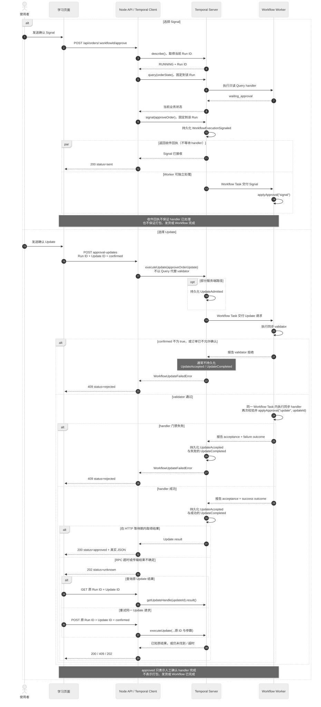

# Signal、Update 与 Query：订单确认对照

本项目用同一个“人工确认订单”动作演示 Temporal 的三种消息交互：

- `approveOrder` Signal：API 得到的是 Temporal Server 的收件回执，业务处理结果要继续观察。
- `approveOrderUpdate` Update：Worker 先运行 validator，再由 handler 返回人工确认的业务结果。
- `orderState` Query：只读当前业务状态，不发送确认，也不修改 Workflow。

三者都不是“订单已发货”的同义词。特别是 Update 返回 `status: "approved"` 时，只能说明人工确认 handler 已完成；后续的 `packOrder`、`shipOrder` 和整个 Workflow 可能仍在运行。



[查看可编辑 Mermaid 源文件](diagrams/signal-update-comparison.mmd)

## 1. 先在页面上做一次对照实验

1. 按[项目 README](../README.md)启动 Temporal、API、Worker 和前端，创建一条普通订单。
2. 等订单进入 `waiting_approval`，在工作流面板的“Signal / Update 对照”区域选择确认方式。新订单默认选中 **Signal**。
3. 若先体验 Signal，直接点击“发送确认 Signal”。页面显示 `status: sent` 的收件回执；随后观察 Query、`WorkflowExecutionSignaled`、发货 Activity 和 Workflow 终态。每条订单只能完成一次确认，比较 Update 时需创建新订单。
4. 若体验 Update，选择 **Update**，先不勾选“我已核对订单信息，确认继续处理”，点击“发送 Update（校验拒绝实验）”。这会向 Workflow 发送一次真实 Update，而不是前端模拟错误；validator 返回 `ApprovalConfirmationRequired`，订单继续等待确认。
5. 勾选复选框后再次发送。页面会为这次新请求生成新的 Update ID；成功时直接展示 handler 返回的真实 JSON。
6. 在事件历史中对照 Update ID，查看 `WorkflowExecutionUpdateAccepted` 和 `WorkflowExecutionUpdateCompleted`。部分服务端路径还可能先出现 `WorkflowExecutionUpdateAdmitted`。

本页面在 validator 拒绝后，会把下一次勾选确认视为新请求并生成新的 Update ID；这是界面策略，不是 Temporal 强制要求。validator 拒绝通常没有 Accepted / Completed 事件，也没有一个可供以后按 ID 取回的“已保存拒绝结果”，因此不能依赖被拒绝 ID 的持久化去重语义。

## 2. Signal、Update、Query 的语义差异

| 对比点 | Signal：`approveOrder` | Update：`approveOrderUpdate` | Query：`orderState` |
| --- | --- | --- | --- |
| 目的 | 向 Workflow 发送确认事件 | 校验并执行确认，取得 handler 结果 | 只读当前业务状态 |
| 是否修改 Workflow | 是，由 Signal handler 修改 | 是，由 Update handler 修改 | 否 |
| 调用返回什么 | Server 已接收 Signal 的回执 | validator / handler 的成功或失败结果 | Query handler 当时返回的状态快照 |
| 本例成功状态 | HTTP 200，`status: sent` | HTTP 200，`status: approved` | HTTP 200 中的 `OrderDetail.state` |
| 是否等待业务 handler | 不等待；收件后即可返回 | 等待 validator 与 handler，除非 RPC 先超时或传输失败 | 等待只读 Query handler |
| Worker 不在线时 | Temporal Server 能直接收 Signal；但本例 HTTP API 先 Query，所以此路由仍需要 Worker | 不能完成 validator / handler；请求可能等待后变为 `unknown` | 通常无法及时回答 |
| 典型 History | `WorkflowExecutionSignaled` | `WorkflowExecutionUpdateAccepted`、`WorkflowExecutionUpdateCompleted`，可能含 `...Admitted` | 不产生对应的持久化业务消息事件 |
| 返回是否表示已发货 | 否 | 否 | 否，只是观察结果 |
| 适合本例的场景 | 只需可靠投递、不需要同步业务返回 | 需要 Workflow 内校验和明确确认结果 | 页面轮询与状态检查 |

`describe()` 和 `fetchHistory()` 由 Temporal Server 提供，与 Query 不同；Worker 停机时，执行元数据和已持久化 History 仍可能可读。

## 3. Workflow 内的共同门禁

共享名称定义在 [`shared/types.ts`](../shared/types.ts)：

```ts
export const APPROVE_SIGNAL = 'approveOrder';
export const APPROVE_UPDATE = 'approveOrderUpdate';
export const STATE_QUERY = 'orderState';
```

Workflow 在第一个 `await` 前注册 Query、Signal 和 Update handler。Signal 与 Update 最终都调用同步函数 `applyApproval`：

```ts
const applyApproval = (method: 'signal' | 'update', updateId?: string): boolean => {
  if (state.status !== 'waiting_approval' || approvalReceived) return false;
  approvalReceived = true;
  state.status = 'running';
  state.approvedAt = timestamp();
  state.approvalMethod = method;
  if (method === 'update' && updateId) state.approvalUpdateId = updateId;
  // 同步更新人工确认步骤
  return true;
};
```

这使两种确认方式遵守同一业务门禁，并在 Query 状态中留下确认方式；Update 还记录 `approvalUpdateId`。

Signal handler 保留原有语义：确认来得太早或重复到达时，`applyApproval` 返回 `false`，handler 静默忽略。Signal 没有向调用方返回业务结果的通道。

## 4. Update validator 与 handler 的边界

Update 的输入是 `{ confirmed: boolean }`。validator 是同步、只读的：

```ts
const validateApprovalUpdate = ({ confirmed }: ApprovalUpdateInput): void => {
  if (confirmed !== true) {
    throw ApplicationFailure.nonRetryable(
      '请先确认已核对订单信息',
      'ApprovalConfirmationRequired',
    );
  }
  if (state.status !== 'waiting_approval' || approvalReceived) {
    throw ApplicationFailure.nonRetryable(
      '当前订单不允许确认',
      'ApprovalNotAllowed',
    );
  }
};
```

validator 只判断是否可以接受 Update，不修改 `state`、不设置 `approvalReceived`，也不安排 Activity。validator 拒绝发生在 Update 被接受之前，因此通常不会有 `WorkflowExecutionUpdateAccepted` 或 `WorkflowExecutionUpdateCompleted`。

handler 会再次调用同一个 validator，然后通过 `currentUpdateInfo()` 取得 Temporal 实际处理的 Update ID，再调用共同的 `applyApproval`。第二次门禁防止 validator 通过后、handler 真正修改状态前出现竞争；若门禁已失效，handler 抛出 `ApprovalNotAllowed`。

本例的 validator 和 handler 都是同步函数。validator 通过后，Worker 在同一个 Workflow Task 中执行 handler，再向 Server 报告 Update acceptance 与 completion outcome；Server 随后把 Accepted、Completed 按顺序写入 History。不要把这个事件顺序误解成“Server 先单独持久化 Accepted，再发起另一轮 handler 执行”。handler 成功返回：

```json
{
  "workflowId": "<learning-order-uuid>",
  "runId": "<run-uuid>",
  "updateId": "<update-uuid>",
  "approvedAt": "<ISO-8601 timestamp>",
  "status": "approved"
}
```

这里的占位符只说明返回结构，不是伪造的一次运行结果。`approved` 只表示人工确认已经应用；心跳场景中的分批打包、发货和 Workflow 完成仍在之后。

## 5. HTTP API 契约

以下命令使用真实路由。先把占位符替换为当前页面或创建接口返回的值；不要照抄尖括号内容当作真实标识。

```bash
BASE_URL='http://127.0.0.1:3001'
WORKFLOW_ID='<learning-order-uuid>'
RUN_ID='<run-uuid>'
UPDATE_ID='<update-uuid>'
```

`runId` 和 `updateId` 都必须是 UUID。`workflowId` 必须属于本示例的 `learning-order-` 前缀。

### 5.1 发送 Signal

```bash
curl -i -X POST \
  "$BASE_URL/api/orders/$WORKFLOW_ID/approve"
```

此路由先对当前执行调用 `describe()`，确认 Temporal 状态为 `RUNNING`；然后固定到 Describe 返回的 Run ID，执行 `query(orderState)` 预检，最后发送 `approveOrder` Signal。成功响应形状为：

```json
{
  "workflowId": "<learning-order-uuid>",
  "runId": "<describe 返回的 run-uuid>",
  "status": "sent",
  "message": "<Server 已接收 Signal 的说明>"
}
```

这是服务端收件回执，不等待 Signal handler 的业务结果，也不表示打包、发货或 Workflow 已完成。它与 handler 的实际运行不存在可依赖的先后保证：Worker 很快时，handler 可能在 HTTP 回执到达页面前已经处理；调用方仍只能把响应解释为“Server 已接收”。Describe 与 Query 预检能给页面更友好的错误，但它们和后续 Signal 不是一个原子事务；真正的最终门禁仍在 Workflow handler。

由于 Query 需要 Worker，这个页面 API 在 Worker 停机时可能超时或失败。若要实验“Worker 停机期间 Server 仍可保存 Signal”，应按[Worker 恢复实验向导](worker-recovery-guide.md)，使用官方 UI 的 `More Actions → Send a Signal` 直接发送无参数 `approveOrder`。

### 5.2 发送 Update

未勾选确认的 validator 拒绝实验：

```bash
curl -i -X POST \
  -H 'Content-Type: application/json' \
  -d "{\"runId\":\"$RUN_ID\",\"updateId\":\"$UPDATE_ID\",\"confirmed\":false}" \
  "$BASE_URL/api/orders/$WORKFLOW_ID/approval-updates"
```

按本页面的实验策略，有效确认示例另用新的 UUID，并把 `confirmed` 改成 `true`；这不是 Temporal 对 validator 拒绝后的强制要求：

```bash
UPDATE_ID='<new-update-uuid>'
curl -i -X POST \
  -H 'Content-Type: application/json' \
  -d "{\"runId\":\"$RUN_ID\",\"updateId\":\"$UPDATE_ID\",\"confirmed\":true}" \
  "$BASE_URL/api/orders/$WORKFLOW_ID/approval-updates"
```

API 固定到请求给出的 Run ID，直接调用 `executeUpdate(approveOrderUpdate)`。它不会先做 Query 并用 Query 结果替代 validator，因为校验和状态修改都必须在 Workflow 内完成。

可能的 HTTP 结果：

| HTTP | `status` | 含义 |
| --- | --- | --- |
| 200 | `approved` | handler 已完成人工确认并返回结果 |
| 409 | `rejected` | validator 或 handler 以 `WorkflowUpdateFailedError` 失败；响应含 `message`，POST 还会尽量返回 `failureType` |
| 202 | `unknown` | RPC 等待超时或传输 / 服务问题，当前 HTTP 调用没有取得确定结果 |
| 400 | 无 Update 业务状态 | JSON 字段、布尔值或 UUID 格式不合法，尚未进入 Workflow validator |

validator 的两类业务失败是：

| `failureType` | `message` | 条件 |
| --- | --- | --- |
| `ApprovalConfirmationRequired` | `请先确认已核对订单信息` | `confirmed !== true` |
| `ApprovalNotAllowed` | `当前订单不允许确认` | 不在 `waiting_approval`，或已经确认 |

### 5.3 查询原 Update 结果

```bash
curl -i \
  "$BASE_URL/api/orders/$WORKFLOW_ID/approval-updates/$UPDATE_ID?runId=$RUN_ID"
```

此路由通过 `getUpdateHandle(updateId).result()` 读取原 Update 的结果，不创建新 Update，也不重新提交新参数：

- 已成功完成：HTTP 200，返回原 `approved` 结果。
- 已接受但 handler 失败：HTTP 409。
- 未找到、RPC 超时或传输问题：HTTP 202，`status: unknown`。

validator 拒绝通常没有持久化为可按 ID 查询的 Accepted / Completed 结果，所以用被 validator 拒绝的 ID 查询时可能得到 `202 unknown`，不能把它描述成“已保存的拒绝去重记录”。

## 6. `unknown` 不是取消

API 在 RPC 超时或传输异常时返回：

```json
{
  "workflowId": "<learning-order-uuid>",
  "runId": "<original-run-uuid>",
  "updateId": "<original-update-uuid>",
  "status": "unknown",
  "message": "<保留原标识并查询或重试的说明>"
}
```

`unknown` 只说明这次 HTTP 等待没有取得最终答案。Update 可能尚未到达 Server、正在排队、已被接受、正在由 Worker 处理，甚至已经完成但响应没有返回；不能据此推断 Update 已取消或未生效。

页面会锁住新的确认方式，并在当前页内存中保留原始 `{ runId, updateId, confirmed }`，提供两种恢复操作：

1. **查询原 Update 结果**：调用 GET；服务端使用 `getUpdateHandle(updateId).result()`，只读取该 ID 的结果。
2. **重试同一 Update ID**：再次 POST，严格复用原 Run ID、Update ID 和 `confirmed`；服务端再次调用 `executeUpdate(...)`，由 Temporal 按同一 Run / Update ID 关联原请求。

不要为“未知”的同一业务意图立刻生成新 ID，否则旧 Update 和新 Update 都可能竞争执行。刷新页面会丢失这份前端内存记录，所以在结果未知时应先保存两个 ID；服务端记录并不会因为刷新而被主动删除。

## 7. 同 ID 重试与去重边界

一个已经被接受的 Update 使用同一 Update ID 重试时，Temporal 会在同一个 Run 内复用原 Update 的处理结果。重试必须保留原参数和原 Run ID；不要把同一 ID 改成另一组参数。

这项去重有明确边界：

- 只针对同一 Workflow Run 中的 Update ID。
- 受 Temporal Server 的事件历史和 Update 结果保留期影响，不能当作无限期业务存储。
- 不跨 Run，也不跨新订单；换一个 Run ID 或 Workflow ID 就不是同一个去重范围。
- 它不是付款幂等。Activity 的外部副作用仍需业务幂等键；本例支付使用 `${workflowId}:charge` 和 SQLite 唯一约束演示另一层问题。
- validator 拒绝发生在 Update 接受之前，不能把该 ID 当作“已持久化的拒绝结果”依赖。

已完成 Update 的结果可以在 Workflow Run 结束后通过 GET 取回，只要服务端仍保留相应信息。不要依赖对终态 Workflow 再发 POST 一定成功；若已有 Update ID，应优先查询该 ID 的原结果。

## 8. 如何读 History

本例在 [`server/history.ts`](../server/history.ts) 中真实转换以下事件，并把 Update 名称和 ID 展示到页面：

| History 事件 | 可以说明什么 | 不能说明什么 |
| --- | --- | --- |
| `WorkflowExecutionSignaled` | Server 已持久化 `approveOrder` | handler 已处理、订单已发货 |
| `WorkflowExecutionUpdateAdmitted` | 某些服务端路径先接纳了 Update | validator 已通过 |
| `WorkflowExecutionUpdateAccepted` | validator 已通过，Update 被接受 | handler 一定成功、订单已完成 |
| `WorkflowExecutionUpdateCompleted` | Update handler 已返回成功或失败 outcome | 后续打包、发货或 Workflow 已完成 |

成功 Update 通常可按同一 Update ID 看到 Accepted 和 Completed 各一次。若 handler 在接受后失败，Completed 事件可包含失败 outcome；页面会显示失败信息。

validator 拒绝通常没有 Accepted / Completed。页面和文档不会为了教学效果伪造这些事件；是否出现 Admitted 也以实际 Temporal 版本和服务端 History 为准。

## 9. Worker 停机实验为什么仍用 Signal

恢复向导的目标是证明：Worker 不在线时，Temporal Server 仍能先持久化外部消息，Worker 重启后再通过历史恢复并处理。这个实验继续使用 Signal：

1. Worker 停止后，先等恢复向导观察到 Query 中断并保存停机 History 边界。
2. 再在官方 UI 选择 `More Actions → Send a Signal`，发送无参数 `approveOrder`。
3. Server 可先记录 `WorkflowExecutionSignaled`，无需 Worker 执行 validator。
4. Worker 重启后处理 Signal，已完成的库存和付款 Activity 由历史恢复，不会因重放重新调用。

Update 不适合替代这个停机收信实验。`executeUpdate` 需要 Worker 执行 validator 和 handler；即使使用等待到 ACCEPTED 的 `startUpdate`，接受本身也依赖 Worker 校验。Worker 停机时，Update 可以排队等待并最终让 HTTP 调用超时，但这展示的是“结果未知 / 等待 Worker”，不是 Signal 的“Server 先持久化消息”语义。

## 10. 源码与验证入口

- [`shared/types.ts`](../shared/types.ts)：Signal / Update / Query 名称、请求与结果类型、`approvalMethod` 和 `approvalUpdateId`。
- [`shared/approval.ts`](../shared/approval.ts)：前端使用的 `approved` / `unknown` 响应和反馈类型。
- [`server/workflows.ts`](../server/workflows.ts)：同步 validator、handler 的二次门禁、`applyApproval` 和返回结果。
- [`server/index.ts`](../server/index.ts)：Signal 的 Describe + Query 预检、Update POST / GET、HTTP 409 / 202 映射。
- [`server/history.ts`](../server/history.ts)：Admitted / Accepted / Completed 的真实 History 展示。
- [`src/api.ts`](../src/api.ts)：浏览器的 Signal、Update、结果查询调用。
- [`src/components/ApprovalComparison.tsx`](../src/components/ApprovalComparison.tsx)：默认 Signal、确认复选框、真实结果、未知结果恢复按钮。
- [`src/App.tsx`](../src/App.tsx)：新 ID 创建、原请求保存、GET 查询和同 ID 重试。
- [`tests/workflow.test.ts`](../tests/workflow.test.ts)：validator 拒绝不修改状态，以及有效 Update 记录确认方式。
- [`tests/api.e2e.ts`](../tests/api.e2e.ts)：真实 API 的拒绝、成功、同 ID 复用、终态 GET 和参数校验。
- [`tests/history.test.ts`](../tests/history.test.ts)：Update History 事件和失败 outcome 的展示。

本地验证命令：

```bash
npm run typecheck
npm test
npm run build

# Temporal、API 和 Worker 已启动时，再运行真实接口测试
npm run test:e2e
```
