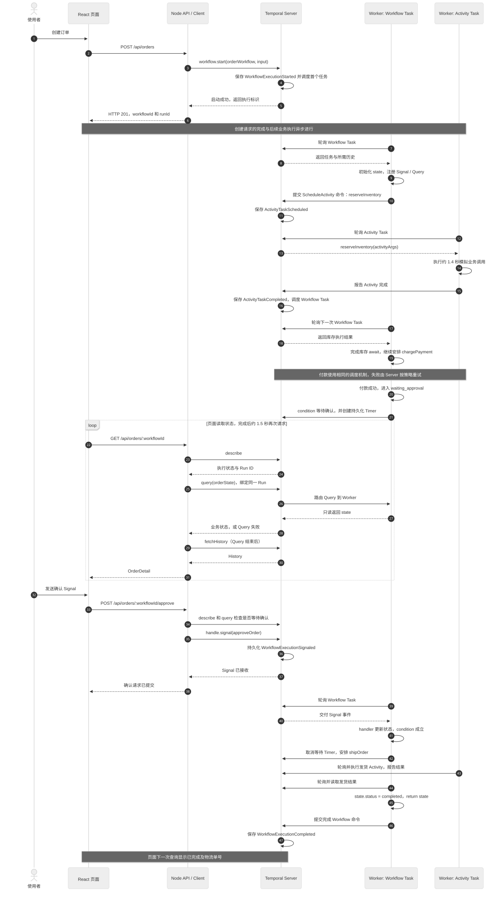
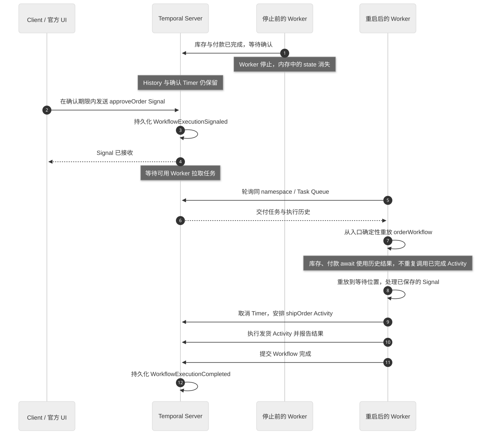

# 结合订单示例理解 Temporal 的执行流程

本文对应本项目的真实实现。建议先按[学习路线](learning-path.md)创建一条「正常处理」订单，使用默认 Signal 完成确认，对照状态与事件历史阅读；理解正常流程后再体验自动重试和其他故障实验。

本例的业务顺序是：

```text
预留库存 → 收取货款 → 等待人工确认 → 可选分批打包 → 创建发货单
```

基础四种场景保持原流程；“长任务心跳”和“心跳超时恢复”在确认后增加 `packOrder`。[Signal、Update 与 Query 对照](signal-update-comparison.md)专门说明两种确认方式的返回语义、validator、未知结果恢复和 History；[幂等、心跳与补偿实验](reliability-experiments.md)说明支付账本、双状态展示和检查点恢复的操作步骤。

理解执行过程时，先记住三个分工：**API 发起操作，Temporal Server 持久化事件并调度任务，Worker 执行业务代码。** 前端负责展示和交互，关闭页面不会停止订单。

## 1. 运行起来的几个进程分别做什么


[查看 Mermaid 源文件](diagrams/runtime-architecture.mmd)

| 角色 | 本例对应位置 | 主要职责 |
| --- | --- | --- |
| 浏览器 | [src/App.tsx](../src/App.tsx)、[src/api.ts](../src/api.ts) | 创建订单、轮询状态、发送确认和取消请求 |
| HTTP API / Temporal Client | [server/index.ts](../server/index.ts)、[server/client.ts](../server/client.ts) | 把 HTTP 请求转成 Temporal 的 start、query、signal、update、cancel 等调用 |
| Temporal Server | [compose.yaml](../compose.yaml) 或 [scripts/temporal-local.ts](../scripts/temporal-local.ts) | 保存 History，管理执行状态、任务队列、重试和持久化 Timer |
| Worker | [server/worker.ts](../server/worker.ts) | 主动拉取任务，执行注册的 Workflow 和 Activity |
| Workflow | [server/workflows.ts](../server/workflows.ts) 中的 `orderWorkflow` | 决定先做什么、等什么、何时结束、失败后如何补偿 |
| Activity | [server/activities.ts](../server/activities.ts) | 执行库存、付款、打包、发货、退款、释放库存等具体操作 |
| 模拟支付账本 | [server/payment-ledger.ts](../server/payment-ledger.ts) | 在独立 SQLite 中记录调用、幂等扣款与退款；API 读取，Activity 写入 |

本例使用一个 Worker 进程同时执行 Workflow Task 和 Activity Task。后面的时序图把它们分成两列，是为了说明两类任务的职责，并不表示需要启动两个 Worker。

### 1.1 几个名称如何对应

| 标识 | 本例中的值 | 用途 |
| --- | --- | --- |
| Namespace | `temporal-learning` | 隔离工作流、历史和任务队列等资源 |
| Task Queue | `temporal-learning-orders` | API 指定任务发到哪里，Worker 指定从哪里领取 |
| Workflow Type | `orderWorkflow` | 告诉 Worker 应执行哪一个已注册的工作流函数 |
| Workflow ID | `learning-order-` 加 UUID | API 为每次新订单创建的标识，用来查询、确认和取消订单 |
| Run ID | Temporal 生成的执行标识 | 标识一次具体的 Workflow Run；本例创建后返回首次 Run ID |
| Query 名称 | `orderState` | 只读查询业务状态 |
| Signal 名称 | `approveOrder` | 传递人工确认事件，调用方只等 Server 收件 |
| Update 名称 | `approveOrderUpdate` | 在 Workflow 内校验并返回人工确认 handler 结果 |

这些共享常量和类型定义在 [shared/types.ts](../shared/types.ts)。API 和 Worker 必须连接相同的 Server、Namespace，并使用相同的 Task Queue，任务才能被正确执行。

**Worker 重启不会新建 Run。** 它恢复的是已有 Workflow Run。本例没有使用 Continue-As-New，也没有配置 Workflow 整体重试；付款重试指的是同一个 Run 内的 Activity 重试。

## 2. 从点击“启动订单”开始看完整过程



[查看大图](diagrams/order-execution-sequence.svg) · [查看 Mermaid 源文件](diagrams/order-execution-sequence.mmd)

这张时序图展示基础订单路径；心跳实验在确认后增加打包 Activity，详见[新增实验](reliability-experiments.md)。图中省略了部分内部任务与事件，用于解释主要交互。创建请求的响应与 Worker 开始执行可以交错，不能把图理解成“HTTP 响应完成后，Worker 才允许工作”。

### 2.1 浏览器提交订单参数

前端向 `POST /api/orders` 提交类似参数：

```json
{
  "customerName": "Temporal 学习者",
  "productId": "keyboard",
  "quantity": 1,
  "scenario": "retry",
  "approvalTimeoutSeconds": 120
}
```

API 使用 [server/validation.ts](../server/validation.ts) 校验姓名、商品、数量、场景和等待时间。超时场景还会把等待时间统一设成 15 秒，避免前端输入改变这个实验的预期行为。

### 2.2 API 创建 Workflow Execution

[server/index.ts](../server/index.ts) 中的创建逻辑如下，省略了 HTTP 响应相关代码：

```ts
const workflowId = `${WORKFLOW_ID_PREFIX}${randomUUID()}`;
const input = normalizeOrder(request.body);
const handle = await client.workflow.start(WORKFLOW_TYPE, {
  workflowId,
  taskQueue: TASK_QUEUE,
  args: [input],
  workflowIdReusePolicy: 'REJECT_DUPLICATE',
});
```

Temporal 接受启动请求后，会保存 `WorkflowExecutionStarted` 等事件，调度首个 Workflow Task。API 返回 HTTP 201 和：

```json
{
  "workflowId": "learning-order-<uuid>",
  "runId": "<Temporal 生成的 Run ID>"
}
```

这里没有调用 `handle.result()` 等待最终结果。因此，“创建成功”的含义是**这次执行已经创建**，后续的付款、确认和发货仍在异步进行。

`REJECT_DUPLICATE` 防止复用同一个 Workflow ID；但本例每次 HTTP 创建请求都会生成新 UUID。如果重复提交同一份订单表单，仍会得到不同订单。实际业务通常应把业务订单号与 Workflow ID 的关系设计清楚。

### 2.3 Worker 拉取首个 Workflow Task

Worker 启动时注册了工作流文件和活动函数：

```ts
const worker = await Worker.create({
  connection,
  namespace: config.namespace,
  taskQueue: TASK_QUEUE,
  workflowsPath: fileURLToPath(new URL('./workflows.ts', import.meta.url)),
  activities,
  shutdownGraceTime: '10s',
  maxHeartbeatThrottleInterval: '500ms',
});
await worker.run();
```

`worker.run()` 持续轮询 Task Queue。拿到 Workflow Task 后，Worker 在 SDK 的工作流运行环境里执行 `orderWorkflow(input)`。

函数首先创建订单的 `state` 和基础四个步骤，心跳场景额外插入打包步骤，并在第一个 `await` 前注册 Query、Signal 与 Update handler：

```ts
setHandler(stateQuery, () => state);
setHandler(approveSignal, () => {
  // 提前或重复 Signal 静默忽略。
  applyApproval('signal');
});
setHandler(approveUpdate, (input) => {
  validateApprovalUpdate(input);
  const updateInfo = currentUpdateInfo();
  if (!updateInfo || !applyApproval('update', updateInfo.id)) {
    throw ApplicationFailure.nonRetryable('当前订单不允许确认', 'ApprovalNotAllowed');
  }
  return { /* workflowId、runId、updateId、approvedAt、status */ };
}, { validator: validateApprovalUpdate });
```

Query 只读状态；Signal 和 Update 通过共同的同步 `applyApproval` 改变确认条件。Update 的同步 validator 只校验，不修改状态；handler 再检查门禁。完整代码与返回语义见[Signal、Update 与 Query 对照](signal-update-comparison.md)。提前注册这些 handler，可以让工作流尽早被查询和接收消息。

### 2.4 遇到第一个 Activity：库存预留

工作流执行：

```ts
updateStep('inventory', 'running', '正在调用 reserveInventory Activity');
await reserveInventory(activityArgs);
inventoryReserved = true;
updateStep('inventory', 'completed', '库存已预留');
```

这里的 `reserveInventory` 来自 `proxyActivities`。这次调用在 Workflow 中表达“安排一个 Activity”，实际函数体由 Activity Task 执行。

它背后的过程是：

1. Workflow 执行到 `await reserveInventory(...)`，产生调度 Activity 的命令，本次编排运行让出。
2. Worker 把 Workflow Task 的完成结果及命令提交给 Temporal。
3. Temporal 保存 `ActivityTaskScheduled`，把 Activity 任务安排到对应队列。
4. Worker 的 Activity 执行器领取任务，运行 `activities.ts` 中的 `reserveInventory`。
5. Activity 完成后，Worker 向 Temporal 报告结果。
6. Temporal 保存 `ActivityTaskCompleted`，调度后续 Workflow Task。
7. Worker 处理新任务，SDK 把 Activity 结果交给等待中的 Workflow，代码继续执行 `inventoryReserved = true`。

**长业务流程由许多短的 Workflow Task 推进。** 等付款、等人工确认时，不需要一个线程持续阻塞在那里，也不需要一个 HTTP 请求一直保持连接。

### 2.5 付款、确认、发货依次推进

库存完成后，`chargePayment` 使用同样的 Activity 调度机制。付款成功后，Workflow 设置：

```ts
state.status = 'waiting_approval';
state.approvalDeadline = new Date(Date.now() + approvalTimeoutMs).toISOString();
updateStep('approval', 'waiting', `等待 approveOrder Signal 或 approveOrderUpdate Update，截止 ${state.approvalDeadline}`);

const approvedInTime = await condition(() => approvalReceived, approvalTimeoutMs);
```

此时业务流程停止向下推进，等待人工确认或超时。收到有效 Signal 或成功 Update 后，`condition` 成立。普通场景安排 `shipOrder`；心跳场景先等待 `packOrder` 的最终结果，再安排 `shipOrder`。

发货 Activity 返回物流单号后，Workflow 更新步骤、设置 `state.status = 'completed'`，最后 `return state`。Worker 向 Server 提交完成命令，Temporal 保存 `WorkflowExecutionCompleted`，整个执行才正式完成。

## 3. Workflow Task 与 Activity Task 有什么区别

| 对比点 | Workflow Task | Activity Task |
| --- | --- | --- |
| 主要问题 | 接下来做什么？ | 这件具体的事怎么做？ |
| 本例代码 | `orderWorkflow`、Signal / Update / Query handler、状态更新、`condition` | `reserveInventory`、`chargePayment`、`shipOrder` 等 |
| 执行内容 | 根据历史推进编排，生成安排活动、创建 Timer、完成执行等命令 | 调用实际业务函数并报告结果 |
| 外部 I/O | 放到 Activity 中处理 | 可以访问网络、数据库、文件等 |
| 恢复机制 | 通过确定性重放恢复编排状态 | 未确认完成的任务可能重新执行，失败可按策略重试 |
| 本例中的执行者 | Worker 的 Workflow 执行器 | 同一个 Worker 的 Activity 执行器 |

一次库存预留、一次付款都可能触发多次 Workflow Task。Workflow Task 的 `Completed` 也只表示“这一轮编排处理完成”，**不能据此判断整个订单已经完成**。

## 4. 自动重试场景到底重试了什么

「自动重试」场景在 Activity 中故意制造失败。下面只保留重试判断，完整实现还记录支付调用流水并执行幂等扣款：

```ts
export async function chargePayment({ input }: OrderActivityArgs): Promise<PaymentResult> {
  const attempt = Context.current().info.attempt;
  await simulatedRequest();

  if (input.scenario === 'failure' || (input.scenario === 'retry' && attempt < 3)) {
    throw ApplicationFailure.retryable(
      `模拟支付网关第 ${attempt} 次调用失败`,
      'PaymentGatewayUnavailable',
    );
  }

  return { attempt };
}
```

付款 Activity 的策略定义在 `workflows.ts`：

```ts
retry: {
  maximumAttempts: 3,
  initialInterval: '1 second',
  backoffCoefficient: 2,
  maximumInterval: '3 seconds',
}
```

因此，同一个 `chargePayment` Activity 执行会经历：

| 总尝试序号 | `retry` 场景结果 | Server 后续处理 |
| --- | --- | --- |
| 1 | 抛出可重试错误 | 退避约 1 秒后安排下一次尝试 |
| 2 | 再次抛出可重试错误 | 退避约 2 秒后安排下一次尝试 |
| 3 | 返回 `{ attempt: 3 }` | 把最终成功结果交给 Workflow |

这里的等待间隔还会叠加执行时间和调度时间。`maximumAttempts: 3` 表示**总共最多三次尝试，包含第一次**。

期间有三个关键事实：

- 重试安排由 Temporal Server 管理，无需在 Workflow 中自己写重试循环。
- Workflow 中的 `await chargePayment(...)` 一直等待最终成功或最终失败，中间两次错误不会立即让整个 Workflow 失败。
- 成功后从付款之后继续，不会因为付款重试而重新预留库存。

短 Activity 每次尝试最长 10 秒、心跳超时 5 秒、最多 3 次尝试；付款另设上述退避参数。`packOrder` 每次尝试最长 45 秒、心跳超时 5 秒、整体调度到完成最长 2 分钟，最多 3 次尝试。这些是 **Activity 策略**，不能理解成“整个 Workflow 最多重跑三次”。

如果选择「失败与补偿」，第三次付款仍失败，Workflow 才会从 `await chargePayment(...)` 收到最终失败，进入 `catch`，释放已预留的库存。

## 5. Signal、Update 和 Query 分别走什么路径


[查看大图](diagrams/signal-update-comparison.svg) · [查看 Mermaid 源文件](diagrams/signal-update-comparison.mmd)

### 5.1 Signal：让流程发生变化

点击“发送确认 Signal”后，浏览器请求：

```text
POST /api/orders/:workflowId/approve
```

API 先检查 Temporal 执行状态是 `RUNNING`，再通过 Query 确认业务状态是 `waiting_approval`，随后执行：

```ts
await handle.signal(APPROVE_SIGNAL);
```

Temporal 会将 `WorkflowExecutionSignaled` 持久化。Worker 随后处理包含这个事件的 Workflow Task，执行注册的 handler，将 `approvalReceived` 设为 `true`，于是等待条件成立。

API 返回成功时，只能确定 Signal 已被 Temporal 接收；它不等待 handler 的业务结果。Worker 可能尚未处理，也可能已经很快处理，不能依赖回执与 handler 的先后顺序。发货和最终完成仍需继续观察状态。

本例还做了两层门禁：

- API 拒绝当前没有等待确认的订单。
- Workflow handler 忽略提前到达、重复到达的确认 Signal。

这意味着，如果绕过 API，在库存或付款阶段就发送确认，本例 handler 会忽略它，不会自动留到人工确认阶段使用。API 的查询检查与随后发 Signal 也不是原子事务，真正影响执行的逻辑仍在 Workflow handler 中。

### 5.2 Update：在 Workflow 内校验并返回结果

页面选择 Update 后，请求 `POST /api/orders/:workflowId/approval-updates`，正文包含固定的 Run ID、UUID Update ID 和布尔 `confirmed`。API 不先做 Query 代替业务校验，而是直接执行 `approveOrderUpdate`。同步 validator 拒绝未勾选确认、非等待状态或已确认的订单；validator 只读，拒绝通常不会产生 `WorkflowExecutionUpdateAccepted / Completed`。

validator 通过后，handler 再检查门禁，调用与 Signal 共用的 `applyApproval`，记录 `approvalMethod = 'update'` 和 `approvalUpdateId`。本例两者都是同步函数：Worker 在同一个 Workflow Task 中执行 validator 和 handler，再向 Server 上报 acceptance 与 completion outcome；Server 随后持久化 Accepted / Completed。成功结果中的 `status: approved` 只表示人工确认 handler 已完成，不表示打包、发货或 Workflow 已完成。

若 RPC 超时或传输异常，API 返回 HTTP 202 和 `status: unknown`。这不能推断 Update 已取消；页面会保留原 Run ID、Update ID 与参数，允许通过 GET 查询原结果，或严格复用同一请求重试。去重只在同一 Run、同一 Update ID 范围内成立，受服务端保留期影响，不是付款幂等或跨 Run 去重。完整接口、失败类型和 History 边界见[Signal、Update 与 Query：订单确认对照](signal-update-comparison.md)。

### 5.3 Query：观察当前状态

页面读取订单详情时，API 先调用 `describe()` 固定 Run，再等待 Query 成功或失败，最后读取 History：

```ts
const queryDeadline = Date.now() + 4_000;
const description = await currentHandle.describe();
const handle = client.workflow.getHandle(workflowId, description.runId);
const stateResult = await client.connection.withDeadline(queryDeadline, () =>
  handle.query<OrderState>(STATE_QUERY),
).then(/* 成功 / 失败处理 */);
const history = await handle.fetchHistory();
```

Describe 和 Query 共用前 4 秒预算，外层操作组仍为 6 秒，给随后读取 History 留出预算。Query 不可用时，响应中的 History 在失败后读取，包含等待期间已入库的事件；恢复向导据此建立中断边界，避免把更早的历史快照当作失败时的边界。这些读取仍不是跨系统原子快照。

三者的含义不同：

| 调用 | 读取内容 | 处理方与特点 |
| --- | --- | --- |
| `describe()` | Temporal 执行状态、Run ID 等元数据 | Server 可以回答，无需运行订单的业务函数 |
| `fetchHistory()` | 已持久化的执行事件 | 从 Server 读取，页面会转换成可读事件 |
| `query('orderState')` | `state` 中的步骤、金额、确认期限、错误和补偿结果 | 通常由 Worker 执行只读 Query handler，必要时先重放历史恢复状态 |

Query 不修改业务状态，也不产生 `WorkflowExecutionSignaled` 这类持久化业务事件。它不是一个“从业务数据库直接读 JSON”的接口。

Worker 停止时，Server 仍可提供元数据和历史，但 Query 可能无法及时得到回答。本例会返回 `state: null` 和 `stateError`；前端若已有快照会保留它，同时标记过期、锁定依赖最新状态的操作。

## 6. 等待确认时，Timer 在哪里

本例通过 `condition(() => approvalReceived, timeout)` 生成持久化等待逻辑。截止时间由 Temporal 管理，工作流没有使用浏览器倒计时决定是否超时。

| 情况 | Workflow 的结果 |
| --- | --- |
| 有效确认先被处理，条件成立 | `condition` 返回 `true`，继续发货，取消等待 Timer |
| 等待超时，条件仍未成立 | `condition` 返回 `false`，进入退款和释放库存分支 |
| Workflow 收到取消 | 等待被取消异常打断，进入取消补偿分支 |

学习页面的初始等待值为 120 秒。API 本身没有默认值，调用方必须提供 5–600 秒的整数；「等待超时」场景会在 API 端统一改为 15 秒。这个期限从**付款成功、开始等待确认时**计算，不是从点击创建订单时开始。

`condition` 超时返回 `false`，不会自动替你退款。本例显式把确认步骤标记为失败，跳过发货，并抛出 `ApprovalTimedOut`，随后由 `catch` 安排补偿。

Worker 停止不会暂停这个期限。Server 可以记录到期事件，后续补偿仍需要 Worker 执行。如果超时和 Signal 接近同时发生，最终分支由历史事件与 Workflow 实际处理结果决定，应查看执行结果，不能只按按钮点击时的浏览器时间判断。

## 7. 失败和取消时，谁负责补偿

Temporal 会执行代码中定义的补偿，业务上的“退款”“释放库存”需要由应用明确编排。

本例在 Activity 成功返回后记录已确认的业务事实，并在发起支付前记录已经尝试支付：

```ts
await reserveInventory(activityArgs);
inventoryReserved = true;

paymentAttempted = true;
const payment = await chargePayment(activityArgs);
paymentCharged = true;
```

补偿函数按逆向业务顺序处理：

1. 只要尝试过支付，就执行幂等 `refundPayment` 查账；所有场景都可能已扣款却没有收到成功结果。有扣款时退款一次，尚未扣款则不产生退款流水。
2. 如果库存已预留，执行 `releaseInventory`。
3. 每项补偿的 `pending → running → completed / failed` 写入 `state.compensationProgress`，页面可观察进行中的步骤。
4. 分别捕获补偿错误，退款失败也继续尝试释放库存，最后写入兼容的摘要文本 `state.compensation`。

这些补偿仍然是普通 Activity，会经历调度、执行和重试。

### 7.1 普通失败

付款持续失败，或人工确认超时后，Workflow 先更新错误、步骤和业务状态，再执行：

```ts
await CancellationScope.nonCancellable(compensate);
throw ApplicationFailure.create({
  message: `订单工作流失败：${originalFailure}`,
  type: 'OrderWorkflowFailed',
  nonRetryable: true,
  // 完整代码还保留 cause 和补偿结果
});
```

最终 Server 记录 `WorkflowExecutionFailed`，执行状态为 `FAILED`。这里使用 SDK 的业务失败类型，可以明确结束 Workflow；任意抛出普通编程 `Error` 可能导致 Workflow Task 失败并重试，语义不同。

### 7.2 主动取消

取消按钮对应 `handle.cancel()`，请求 Temporal 发出协作式取消。Workflow 同时检查收到的异常和取消作用域：

```ts
const scope = CancellationScope.current();
if (isCancellation(error) || scope.consideredCancelled) {
  state.status = 'cancelled';
  state.error = '工作流收到取消请求';
  markUnfinishedCancelled('工作流已取消，此步骤不再执行');
  await CancellationScope.nonCancellable(compensate);
  if (scope.consideredCancelled) await scope.cancelRequested;
  throw error;
}
```

心跳暂停期间，Activity 可能先返回超时；作用域已取消时，等待 `cancelRequested` 会抛出 SDK 取消异常，使补偿后的最终结果仍为 `CANCELLED`。没有取消请求的超时按普通重试和失败规则处理。

根取消作用域此时已经取消，如果直接在里面安排退款，退款也可能立即被取消。因此使用 `nonCancellable` 保护清理过程。最后重新抛出取消异常，让 Temporal 的最终执行状态保留为 `CANCELLED`。

`cancel()` 成功只表示取消请求已提交。补偿 Activity 仍需时间运行；Worker 不在线时，不能立即完成业务清理。强制 `terminate` 不会正常执行这个 `catch` 补偿分支，本例 API 使用的是 `cancel`。

### 7.3 两套状态为什么可能暂时不同

| 返回字段 | 表示什么 | 示例 |
| --- | --- | --- |
| `OrderDetail.status` | Temporal Execution 状态 | `RUNNING`、`COMPLETED`、`FAILED`、`CANCELLED` |
| `OrderDetail.state.status` | 应用定义的业务状态 | `running`、`waiting_approval`、`completed`、`failed`、`cancelled` |

页面并列展示这两套状态，以及 `state.compensationProgress` 中每项补偿的进度。当前代码会在补偿前设置业务状态。因此，短时间内看到 `state.status = failed`，同时 Temporal 仍为 `RUNNING`，可能只是退款或释放库存还在执行。Describe 与 Query 不是原子快照，接近结束时也可能短暂观察到不同步，后续轮询会刷新。

最终结论应结合 Execution 状态、补偿详情和 History。步骤中的 `cancelled` 也可能只表示“因前序失败跳过”，不能据此认定整个 Workflow 的 Execution 是 `CANCELLED`。

## 8. Worker 重启后，为什么能接着执行



[查看 Mermaid 源文件](diagrams/worker-recovery.mmd)

假设库存和付款已完成，Workflow 正等待人工确认。此时停止 Worker，它的普通内存状态确实会消失，但 Server 中保留了：

- Workflow 启动时的输入。
- 已安排并完成的 Activity，以及已记录的结果。
- 已创建的确认 Timer。
- 停机期间接收并持久化的 Signal 等事件。

新 Worker 连接同一个 Namespace / Task Queue 后，可以领取待处理任务，通过历史恢复运行状态。

### 8.1 重放执行的是编排代码

SDK 可以从 `orderWorkflow(input)` 入口重新执行确定性的编排逻辑。重放到：

```ts
await reserveInventory(activityArgs);
await chargePayment(activityArgs);
```

如果历史已经记录了它们的完成结果，SDK 会使用历史结果推进这两个 `await`，不会因为重放就再次调用库存和支付接口。局部变量如 `inventoryReserved`、`paymentCharged` 也会随相同代码路径重新建立。

随后代码回到等待确认的位置，处理已经保存的 Signal 或 Timer 结果，继续发货或执行超时补偿。

运行中的 Worker 可以缓存工作流状态，并非每一次 Workflow Task 都必须从头完整重放；重放是恢复状态的机制。

### 8.2 重放与 Activity 重新执行要分清

| 情况 | 外部业务操作会不会再调用 |
| --- | --- |
| 重放一个已记录成功结果的 Activity | 使用历史结果，不因重放再次调用 |
| Activity 返回可重试失败 | 按策略真实调用下一次尝试 |
| Activity 外部操作成功，但完成结果未被 Temporal 确认就发生故障 | 可能重新执行，必须使用幂等设计 |

第三种情况说明了为什么生产支付接口仍需幂等。History 并没有与外部支付系统共享一个原子事务。

本例新增独立 SQLite 模拟账本：`chargePayment` 使用 `${workflowId}:charge` 作为稳定幂等键，通过唯一约束和事务保证重复调用只入账一次。“支付幂等”场景故意在账本提交后抛错，让第二次 Activity 尝试复用原付款。取消或最终失败时，即使 Workflow 未拿到付款成功结果，也会在该场景中查询并幂等退款。它演示了结果不确定性的一种处理方式；真实支付仍需外部系统的幂等接口、状态查询和对账。

### 8.3 Workflow 为什么要求确定性

恢复时，SDK 需要让编排代码与历史保持一致。网络响应、文件内容、普通随机函数等不稳定因素，应放进 Activity，并把结果记录进历史。

本例 Workflow 使用了 `new Date()` 和 `Date.now()`，它们在 Temporal Workflow 环境中由 SDK 提供确定性语义。Activity 则运行在普通 Node 环境里。

修改工作流也需要考虑旧历史的重放兼容性。学习时可以先结束运行中的订单再改流程；实际部署需根据变更使用版本兼容机制。

## 9. 前端为什么能持续观察流程

前端会分别轮询：

| 数据 | 同一次请求结束后的等待间隔 | 作用 |
| --- | --- | --- |
| `/api/health` | 3 秒 | 检查 Server、最近的 Worker Poller |
| `/api/orders` | 4 秒 | 从 Visibility 查询最近最多 50 条实验记录 |
| `/api/orders/:workflowId` | 1.5 秒 | 读取执行状态、业务状态、History、Pending Activities 心跳与支付账本 |

实际刷新周期还包括请求耗时。这些间隔影响展示速度，不影响 Temporal 的调度、重试和业务超时。

创建接口返回后，前端直接使用 Workflow ID 查询详情，不必等 Visibility 列表更新。Visibility 是最终一致的检索视图，列表中暂时没有新订单不代表启动失败。

API 的首次连接等待为最多 3 秒，连接后每次 `withTemporal` 操作组设置 6 秒 deadline。这个 deadline 用于避免 HTTP 请求一直等待；它不会把一个等待 120 秒人工确认的 Workflow 限制成 6 秒。

Worker 健康状态来自最近 90 秒内的 Poller 记录，停止 Worker 后可能短暂显示仍就绪。Query 能否成功也要结合当前 Worker 可用性判断。

### 9.1 如何读事件历史

| 典型事件 | 可以说明什么 |
| --- | --- |
| `WorkflowExecutionStarted` | 执行已创建 |
| `WorkflowTaskScheduled / Started / Completed` | 某一轮编排任务被安排、执行、提交 |
| `ActivityTaskScheduled` | Workflow 安排了具体 Activity |
| `ActivityTaskStarted` | Activity 的执行信息，可查看最终记录的 `attempt` |
| `ActivityTaskCompleted` | Activity 成功结果已被记录 |
| `ActivityTaskFailed` | Activity 最终失败；本例付款场景会在重试耗尽后出现 |
| `WorkflowExecutionSignaled` | Signal 已持久化，但不等于 handler 或后续业务已完成 |
| `WorkflowExecutionUpdateAdmitted` | 部分路径记录 Update 已接纳；是否出现以真实 History 为准 |
| `WorkflowExecutionUpdateAccepted` | validator 已通过，Update 已接受 |
| `WorkflowExecutionUpdateCompleted` | Update handler 已返回成功或失败 outcome；不等于 Workflow 已完成 |
| `TimerStarted / Fired / Canceled` | 等待 Timer 被创建、触发或取消 |
| `WorkflowExecutionCancelRequested` | 收到取消请求，仍可能等待补偿 |
| `WorkflowExecutionCompleted / Failed / Canceled` | 执行进入相应终态 |

Temporal 会优化 Activity 重试的历史记录，中间失败不一定逐次显示成完整的 `Started → Failed` 事件对。观察重试应结合最终 `attempt`、Worker 日志和官方 UI 的 Pending Activities。

Update validator 在接受前拒绝时通常没有 Accepted / Completed 事件；不能为了展示而补造。成功 Update 通常能按同一 Update ID 对上 Accepted 和 Completed，handler 失败则可在 Completed outcome 中看到失败。Admitted 是否出现取决于实际服务端路径和版本。

本例 [server/history.ts](../server/history.ts) 转换事件名称、时间、活动关联、Update ID / 名称和部分错误信息。页面提供可读视图；更完整的事件属性和 Payload 可在官方 UI 中查看。

## 10. 对照页面做实验

先按[项目 README](../README.md)启动环境。查看官方 UI 时选择 `temporal-learning` Namespace。

| 实验 | 页面操作 | 重点观察 |
| --- | --- | --- |
| 正常执行 | 选择正常处理，付款后发送 Signal | 收件回执、`WorkflowExecutionSignaled`、Timer 取消、发货和最终完成 |
| Update 校验拒绝 | 新订单等待确认时选择 Update，先不勾选复选框 | 409 `ApprovalConfirmationRequired`、订单继续等待、通常无 Accepted / Completed |
| Update 确认与恢复 | 页面勾选后以新 ID 发送；若结果未知，查询或同 ID 重试 | 真实返回 JSON、Accepted / Completed、同 Run 去重和后续发货 |
| 自动重试 | 选择自动重试，最后人工确认 | 付款成功的第 3 次尝试；库存不重复执行 |
| 重试耗尽 | 选择失败与补偿 | 付款失败、`releaseInventory`、最终 `FAILED` |
| 持久化超时 | 选择等待超时，保持不确认 | `TimerFired`、退款、释放库存、最终 `FAILED` |
| Worker 恢复 | 使用“Worker 恢复实验”向导，保存基线后停止并重启 | 同一 Run、Query 中断与恢复、已完成付款没有重做 |
| 打包进程崩溃 | 在向导的打包模式中保存检查点并结束 Worker | 新 Activity 尝试从服务端检查点继续，账本保持不变 |
| 支付幂等 | 选择支付幂等，等待自动重试 | 2 次调用、1 次扣款、幂等命中流水 |
| 长任务取消 | 长任务心跳场景，确认后在打包中取消 | 心跳批次停止、逐项补偿、最终 `CANCELLED` |
| 心跳超时 | 选择心跳超时恢复，确认后等待 | 第一次心跳暂停、后续尝试从已保存检查点继续 |

要单独控制 Worker，可分别运行：

```bash
# Temporal 先保持运行；Docker 模式或原生模式任选一种
npm run temporal:up
# 原生模式用单独终端运行：npm run temporal:local

# 三个独立终端
npm run dev:api
npm run worker:recovery
npm run dev:web
```

`worker:recovery` 无热重载，并打印实际 Worker PID，便于观察完整停机窗口。页面的[恢复实验向导](worker-recovery-guide.md)提供四步操作、基线和实时对照。

等待确认恢复实验可以这样操作：

1. 按[恢复向导](worker-recovery-guide.md)创建正常订单，等待人工确认，保存同一 Workflow ID / Run ID 的基线。
2. 在 Worker 终端按 `Ctrl+C`，保持 Temporal、API 和前端运行。先等向导记录 Query 中断和其后的 History 边界。
3. 在确认期限内，通过官方 UI 发送无参数的 `approveOrder` Signal。页面的确认 API 依赖 Query，Worker 停止时它可能暂时不可用。
4. 向导观察到边界之后的 Signal 入库，再重新运行 `npm run worker:recovery`。
5. 观察同一 Run 的后续 Workflow Task、发货、完成事件及账本。先恢复再确认也能展示编排继续，但不能证明停机期间收到了 Signal。

若没有确认且超过等待期限，恢复后应观察超时补偿分支。只有 Temporal Server 和它的持久化数据仍在，恢复才有依据。

## 11. 学习示例与实际业务的边界

本例主要解释调度与恢复机制，下面几个细节在接入真实业务时需要补齐：

- **幂等与结果不确定性：** 扣款、退款、库存操作、发货都可能重试，应使用能跨尝试保持稳定的业务幂等键。本例每次创建都生成新 Workflow ID，不会自动去重重复 HTTP 提交。
- **取消与心跳：** 短 Activity 每 200 毫秒调用 heartbeat，打包 Activity 每批约 1 秒发送检查点；Worker 的心跳发送最多节流 500 毫秒。心跳接收 Server 取消通知，`Context.sleep` 响应本地上下文已收到的取消；配置为 `WAIT_CANCELLATION_COMPLETED`，Workflow 等待 Activity 退出后再补偿。故障注入期间故意不发心跳，取消也可能等到心跳超时或旧尝试退出。检查点是最近送达 Server 的进度，真实批次操作仍需幂等，不能把它当作精确一次保证。
- **补偿不是数据库回滚：** 每个补偿都是可能再次失败的业务调用。代码会记录补偿失败，并继续尝试其他补偿；实际系统还需人工处理或后续恢复机制。
- **数据存储位置：** 原生服务把数据放在 `.temporal/learning.db`，Docker 服务把数据库放在命名卷中；两个模式不会自动共享历史。模拟支付另存 `.data/payments.db`，不属于 Temporal History，旧订单不会补写流水；切换 Temporal 数据源也不会自动切换账本。API 与 Worker 必须使用相同的账本路径。

## 12. 按这个顺序回看代码

第一遍沿一条正常订单追踪调用，暂时跳过 Update 恢复、展示状态和补偿细节：

1. [server/index.ts](../server/index.ts)：找到创建订单接口中的 `workflow.start`，理解请求返回执行标识后，业务仍会异步运行。
2. [server/worker.ts](../server/worker.ts)：看 Worker 如何注册 Workflow 和 Activity，以及 Server、Namespace、Task Queue 如何对应。
3. [server/workflows.ts](../server/workflows.ts)：先看 `proxyActivities` 和 `orderWorkflow` 中预留库存、付款、`condition`、发货的编排主干。
4. [server/activities.ts](../server/activities.ts)：看代理调用对应的普通 Node 函数，区分编排与外部操作。遇到类型问题时回查 [shared/types.ts](../shared/types.ts)。

完成恢复与故障实验后，再按需要深入：

- 回到 Workflow 阅读 `setHandler`、重试配置、取消作用域和补偿；回到 API 阅读 `query`、`signal`、`executeUpdate`、`getUpdateHandle`、`cancel`。
- [server/history.ts](../server/history.ts)：把页面事件与 SDK 的 History 对上。
- [server/payment-ledger.ts](../server/payment-ledger.ts)、[server/pending-activities.ts](../server/pending-activities.ts)：理解独立支付账本与服务端心跳的观测方式。
- [src/App.tsx](../src/App.tsx)：理解前端轮询、旧快照提示和操作状态。
- [tests/workflow.test.ts](../tests/workflow.test.ts)、[tests/experiments.test.ts](../tests/experiments.test.ts)、[tests/api.e2e.ts](../tests/api.e2e.ts)：查看正常、重试、失败、超时、幂等、心跳和取消分支的验证方式。

延伸阅读：[TypeScript SDK](https://docs.temporal.io/develop/typescript)、[消息传递](https://docs.temporal.io/develop/typescript/message-passing)、[故障检测与重试](https://docs.temporal.io/develop/typescript/failure-detection)。
