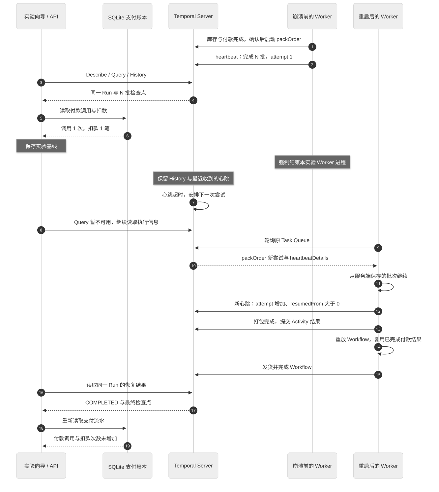

# Worker 恢复实验向导

页面上的“Worker 恢复实验”把[执行流程中的历史重放](temporal-execution-flow.md)和[长 Activity 的检查点恢复](reliability-experiments.md)拆成两组可操作实验：先保存真实基线，在终端停止 Worker，再对照同一个 Workflow ID / Run ID 的结果。

向导不会操作进程。“已停止”“已重启”按钮只记录操作者完成了哪一步；恢复结论来自 API 读到的真实执行状态、Query、History、Pending Activity 和独立支付账本。

## 1. 启动准备

在项目目录运行。Temporal 只启动一次，使用原生服务或 Docker 二选一；已运行时无需重复启动：

```bash
npm run temporal:local
# 或 npm run temporal:up
```

API、Worker、前端分别放在独立终端：

```bash
# 终端 A
npm run dev:api

# 终端 B：恢复实验使用这个命令
npm run worker:recovery

# 终端 C
npm run dev:web
```

如果此前使用 `npm run dev`，先停止它，再按上面分别启动应用进程，避免重复占端口。保持 Temporal、API、前端运行；整个任务队列只保留一个 Worker，否则另一进程可能接走任务，让停机窗口无法出现。

`worker:recovery` 使用 `tsx server/worker.ts`，没有文件热重载监控。Worker 就绪后打印：

```text
Worker 已就绪，监听任务队列 temporal-learning-orders
Worker PID: 12345（恢复实验只操作此进程）
```

`12345` 只是格式示例。实际操作使用自己终端打印的 PID。API 和 Worker 需要读取相同的 `.data/payments.db`，自定义 `PAYMENT_DB_PATH` 时也需一致。

打开 <http://localhost:5173>，从顶部进入“恢复实验”工作区，查看“Worker 恢复实验”向导。两种模式都可一键创建实验订单：机械键盘 1 件，人工确认期限 300 秒。也可以在“实验台 → 最近实验”选择已有且符合准备条件的订单，再返回向导。

## 2. 实验一：等待确认时重启

目标：观察 Signal 在 Worker 停机期间被 Server 保存，Worker 重启后恢复编排；已完成的库存和付款 Activity 使用历史结果，不会重新安排。本实验刻意使用 Signal，不用 Update 替代。

### 操作步骤

1. 选择“等待确认时重启”，点击“创建等待确认实验订单”。它使用 `normal` 场景。
2. 等待库存、付款完成，订单停在 `waiting_approval`。向导会要求新鲜 Query、Temporal `RUNNING`、账本调用 1 次、扣款 1 笔、没有退款。
3. 点击“保存实验前快照”。向导记录 Workflow ID、Run ID、History 边界、已完成 Activity 的事件 ID，以及付款次数和金额。
4. 在终端 B 按 `Ctrl+C`，等待 Worker 退出。回到页面点击“已在终端停止 Worker”。
5. 保持 Worker 停止，**先等向导显示同一 Run 仍为 `RUNNING`、Query 不可用，并记录 History 边界 `#N`**。请求可能约 4–6 秒后才返回；看到边界前不要发送确认。
6. 在向导中打开本次执行的官方 Temporal UI，选择 `More Actions → Send a Signal`，填写 `approveOrder`，不需要参数。保持 Worker 停止，等待下一份响应认证事件 ID 大于 `N` 的 `WorkflowExecutionSignaled`。普通订单页的确认接口需要先 Query，Worker 停机时可能失败。
7. 不要改用 Update 完成这一步：`executeUpdate` 需要 Worker 执行 validator 和 handler；即使等待到 ACCEPTED，接受也依赖 Worker 校验。停机时它可能排队并让 HTTP 调用超时，不能替代本实验要观察的 Signal 入库语义。
8. 在终端 B 重新运行 `npm run worker:recovery`。看到就绪提示后，点击“已在终端重启，开始核对”。
9. 等待 Query 恢复、订单发货并完成，查看各项核对结果。

### 应观察到的结果

| 观察项 | 证据 |
| --- | --- |
| 执行身份保持 | Workflow ID 和 Run ID 都与基线一致 |
| 中断与恢复 | 同一 Run 仍为 `RUNNING` 时 Query 不可用并保存 History 边界，重启阶段重新得到新鲜 Query |
| Signal 已持久化 | 建立中断边界后，在停机阶段后续响应中认证新增的 `approveOrder`；认证后固定事件 ID |
| 编排继续 | 该 Signal 之后出现新的 Workflow Task 完成事件，最终执行为 `COMPLETED`、Query 为 `completed` |
| 已完成活动未重新安排 | 原库存、付款完成事件仍存在，没有基线之后新增的库存、付款调度 |
| 付款未再调用 | 付款调用次数、扣款次数和金额均与基线相同，没有退款 |

可结合已有的[Worker 重启恢复图](diagrams/worker-recovery.svg)阅读。[可编辑 Mermaid](diagrams/worker-recovery.mmd)。

### Timer 不会暂停

人工确认使用持久化 Timer。页面显示的确认截止时间在 Worker 停机期间仍然向前推进。建议保存基线后尽快完成操作。

Signal 入库不等于业务 handler 已处理，也不等于订单已经完成。若在超时附近操作，最终分支取决于持久化事件历史与 Workflow 实际处理顺序；不要只按浏览器时钟推断。若最终走失败或补偿分支，向导应显示实际结果，不会把点击“重启”当作成功。

Signal 与 Update 的完整接口和返回语义见[Signal、Update 与 Query：订单确认对照](signal-update-comparison.md)。恢复向导使用 Signal 是实验设计的一部分：Update 的 validator、handler，以及等待到 ACCEPTED 的调用都需要 Worker 处理；停机时 HTTP 超时只能说明结果未知。

## 3. 实验二：打包期间崩溃

目标：观察未完成 Activity 重新执行时，如何从服务端最近保存的 heartbeat details 恢复。它与实验一中的 Workflow 历史重放处在不同层次。

### 为什么这组实验使用强制结束

当前 Worker 配置 `shutdownGraceTime: '10s'`，正常 `Ctrl+C` 会给正在执行的 Activity 退出宽限期。打包只有 12 批，每批约 1 秒，可能在 Worker 完全退出前就执行完毕。

为稳定制造未完成 Activity，这组实验使用无热重载的 `worker:recovery`，并强制结束该 Worker 进程。热重载命令 `dev:worker` 可能在子进程退出后再次启动它，因此不适合这组停机观察。

### 操作步骤

1. 选择“打包期间崩溃”，点击“创建打包恢复实验订单”。它使用 `heartbeat` 场景，不使用会自动注入心跳故障的 `heartbeat_timeout`。
2. 等待付款完成，点击“确认并开始打包”。
3. 看到服务端检查点至少完成 1 批、尚未完成全部 12 批，且检查点属于当前 Pending Activity 尝试时，点击“保存实验前快照”。
4. 立即在另一个终端运行下方命令，把占位符替换为终端 B 打印的真实 PID：

   ```bash
   kill -KILL <Worker_PID>
   ```

   例如终端真实显示 PID 为 `12345` 时才使用 `kill -KILL 12345`。只结束本实验的 Worker。

5. 回到页面点击“已在终端停止 Worker”，等待 Query 中断证据。Server 在最后心跳超过 5 秒后可判定心跳超时，并安排重试；此时没有 Worker 拉取下一次任务。
6. 在终端 B 运行 `npm run worker:recovery`，看到就绪提示后点击“已在终端重启，开始核对”。
7. 观察新尝试的检查点、恢复起点和最后完成结果。

打包 Activity 整体的 `scheduleToCloseTimeout` 为 2 分钟，包含排队、执行和重试；操作不要停留过久。若未及时中断，原尝试已经完成，可以清除向导记录后创建新订单重做。

### 应观察到的结果

- Workflow ID / Run ID 保持不变。
- 打包进入高于基线的新尝试；Pending Activity 的当前尝试号与心跳 Payload 的 `attempt` 一致，才能把它当作新尝试的检查点。
- `resumedFrom` 大于 0，且不小于基线里已保存的批次。它可能比基线更大，因为保存快照到实际结束进程之间，Worker 可能又完成并上报了若干批。
- 完成后，Query 的 `state.packing` 保留最终 `attempt`、`resumedFrom`、12/12 批结果。
- 已完成的付款没有再次调用；账本调用次数、扣款和金额不增加。
- 最终执行为 `COMPLETED`。



[可编辑 Mermaid 源文件](diagrams/packing-worker-recovery.mmd)。

检查点是 Server 最后保存的进度，不是进程被终止瞬间的内存。实际系统仍应让每批副作用幂等；本例打包只有等待和心跳，没有物理打包操作。

## 4. 向导如何判断

### 数据来源与边界

| 内容 | 来源 | 用途 |
| --- | --- | --- |
| Workflow ID / Run ID / 执行状态 | Describe | 锁定同一次执行及最终状态 |
| 业务阶段、最终打包结果 | `orderState` Query | 判断准备条件、业务完成与最终恢复起点 |
| 当前打包尝试、心跳 | Describe 的 Pending Activities | 观察未完成 Activity 的真实检查点 |
| 已完成活动、Signal、Workflow Task | History 的结构化字段 | 比较保存基线前后的持久化事件 |
| 付款调用、扣款、退款 | SQLite 支付账本 | 核对外部业务效果，而非仅数 History 事件 |
| 停止、重启阶段 | 当前向导记录及点击时已读取的 API 响应时间 | 要求后续服务端响应再提供证据；不使用浏览器时钟证明事件顺序 |

Describe、Query、History、账本不是跨系统原子快照，结束边界可能要等下一次响应才全部一致。API 在 Query 失败后仍返回执行信息、History 和账本；Query 不可用响应中的 History 在 Query 失败后读取，作为停机窗口边界，包含等待 Query 期间已入库的事件。停机时请求可能约 4–6 秒才返回：Describe 与 Query 使用前 4 秒预算，整个请求受外层 6 秒 RPC deadline 约束；页面在请求结束后约 1.5 秒再轮询，不是每 1.5 秒必得一份完整响应。

向导采用保守核对：

- 确认基线除新鲜 Query 为 `waiting_approval` 外，还要求完整 History 没有确认 Signal、已接受的确认 Update、打包或发货调度及执行终结事件，且 Query 没有 `approvedAt` 或已完成的确认步骤；发现矛盾时等待一致响应或新建订单重做，停止阶段也会复核，不能把推进事件纳入基线后隐藏。
- 同一份已读取的响应不能因点击阶段按钮而变成新证据。按钮保存当前 API 响应的 `observedAt`，只采集服务端时间更晚的响应；响应倒序或 History 回退不会覆盖新证据。浏览器时间不与服务端事件时间比较。
- 确认恢复必须先在同一 Run 仍为 `RUNNING` 时观察到 Query 中断，保存这份 History 的最大事件 ID，再在停机阶段后续响应中认证大于该边界的 `approveOrder`。只晚于最初基线不够。
- 首次中断响应已经含有基线后的确认 Signal、已接受的确认 Update、后续发货调度或执行已结束时，无法证明停机先于确认，向导会要求重做。先确认完成订单、后停 Worker 同样不能通过。
- 重启阶段不能首次补认停机 Signal。已认证的 Signal 事件 ID 固定，后续重复 Signal 不会替换它；编排继续需要该事件之后的 Workflow Task 完成证据。
- 记录停止时，执行必须仍为 `RUNNING`。重启核对前若已采集有效停机中断，确认模式还已认证边界后的 Signal，即使重启后轮询先读到新鲜 `COMPLETED`，也允许点击进入核对；打包模式同样适用，但检查点仍需单独验证。按钮只保存响应边界，Query 恢复和最终检查点仍由后续新鲜响应确认。
- 缺少停机窗口、停止前已完成、失败或取消等其它终态、异 Run、过期响应，以及付款或 History 错误仍会阻止记录阶段，并显示原因。新建订单重做时先等待中断边界，再发送 Signal。
- Query 缓存可能仍显示旧业务状态，`stateError` 与页面过期标记会阻止把它当作新鲜 Query。
- 响应失败或切换到其他订单时，当前动态结论等待新观测；不会套用其他 Run 的付款或心跳。
- 当前 Pending Activity 尝试号增加，但心跳 Payload 仍属于旧尝试时，尚不能认定检查点恢复成功。
- 只重新从 0 开始、缺少新尝试或缺少中断窗口证据时，不给出“恢复证据齐全”。
- 取消、失败、退款或付款重新调用会如实显示，不能被“订单最后有结果”覆盖。

Query 中断可能由 Worker 停机、网络或任务调度导致；恢复证据也不能单独证明某个操作系统 PID 曾被结束。进程停止和重启需以终端为准。顶部健康状态使用最近 90 秒内的 Poller 记录，停机后仍可能短暂显示就绪，不能用它判断实时进程状态。

### 记录生命周期

向导记录保存在当前 React 页面内存里。收起向导或切换到实验台、学习路线、自测笔记时继续采集，顶部会显示“观察中”；刷新页面会清空。清除向导记录不取消 Workflow，不删除 Temporal History 或支付账本。执行和真实事件可以继续在订单列表、检查器与官方 UI 查看。

## 5. 常见结果

| 现象 | 解释与下一步 |
| --- | --- |
| 停止后 Query 仍一直可用 | 核对是否还有第二个 Worker，或热重载监控已重启子进程 |
| 重启后 Query 恢复，但缺少中断证据 | 停机窗口太短或没有采集到失败响应；重新实验，等待向导读到中断后再启动 |
| 首次中断响应已包含确认 Signal | 该响应不能证明停机先于 Signal；清除记录并新建订单，先等 History 中断边界再发送 |
| Signal 重启后才首次出现 | 重启响应不能补认停机窗口；重新实验并在重启前等 Signal 入库证据 |
| 未取得停机证据，订单已完成且按钮不可用 | 执行已结束，无法再建立恢复窗口；清除记录并新建订单重做 |
| 停机证据齐全，Worker 重启后在点击按钮前已完成 | 可继续点击“已在终端重启，开始核对”，等待下一份响应验证 Query 恢复；确认模式需已有认证 Signal，打包模式继续核对恢复检查点 |
| 打包还是尝试 1，直接完成 | 中断太晚，或优雅退出期间已做完；用无热重载 Worker，在较早批次强制结束 |
| 尝试 2，心跳还是尝试 1 | Server 已准备重试，但新 Worker 尚未上报新心跳；继续观察 |
| 新尝试从 0 开始 | 没有取到服务端检查点，不能判定本次检查点实验通过 |
| 执行失败并退款 | 查看 History 和补偿，检查人工确认或打包整体时限是否已超出 |
| 账本为空 | 旧订单、路径不一致或数据已清除；向导要求有效付款基线，创建新实验订单并核对配置 |

## 6. 源码和验证入口

- [src/components/RecoveryGuide.tsx](../src/components/RecoveryGuide.tsx)：四步交互、终端指引、当前数据对照和阶段记录。
- [src/recovery.ts](../src/recovery.ts)：准备条件、基线、证据采集与保守核对。
- [src/App.tsx](../src/App.tsx)：复用真实 API 轮询、处理 Query 缓存与订单切换。
- [server/history.ts](../server/history.ts)、[shared/types.ts](../shared/types.ts)：结构化 Activity 类型、尝试号和 Signal 名称，避免解析展示文案。
- [server/worker.ts](../server/worker.ts)：打印实际进程 PID、退出宽限期与心跳节流配置。
- [tests/recovery.test.ts](../tests/recovery.test.ts)：停机前已完成、首个中断快照含 Signal、重启后才出现 Signal、固定认证事件、阶段按钮、错 Run、旧响应、旧心跳、重复付款和正确恢复的回归测试。

```bash
npm test
npm run build
```

页面验收还需实际停止和重启独立 Worker，分别走完上述两组操作。仅运行判定函数或点击按钮不能代替进程恢复实验。
